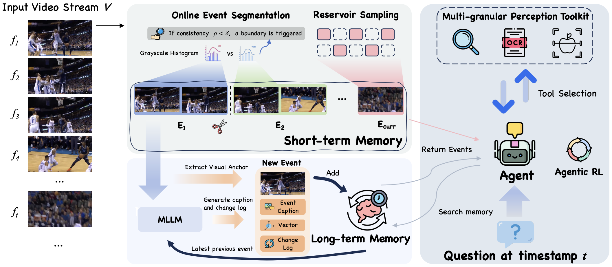

<div align="center">

<h2>🎬 EventMemAgent: Hierarchical Event-Centric Memory for<br>Online Video Understanding with Adaptive Tool Use</h2>

<p><b>ECCV 2026</b></p>

[Siwei Wen](https://scholar.google.com/citations?user=kJRiUYwAAAAJ&hl=zh-CN)<sup>1</sup>,
Zhangcheng Wang<sup>3</sup>,
[Xingjian Zhang](https://scholar.google.com/citations?user=H34fwioAAAAJ&hl=zh-CN)<sup>1</sup>,
[Lei Huang](https://huangleibuaa.github.io/)<sup>1,2</sup>,
[Wenjun Wu](https://openreview.net/profile?id=~wenjun_wu3)<sup>1,2</sup>

<sup>1</sup>Beihang University &nbsp;&nbsp; <sup>3</sup>4Paradigm Inc.<br>
<sup>2</sup>Hangzhou International Innovation Institute, Beihang University

</div>

<div align="center">

[](https://arxiv.org/abs/2602.15329)
[](https://huggingface.co/lingcco/EventMemAgent-8B)
[](https://huggingface.co/datasets/lingcco/EventMemAgent)
<br>
[](https://github.com/lingcco/EventMemAgent/issues)
[](LICENSE)
[](https://github.com/lingcco/EventMemAgent/stargazers)

</div>

## 📰 News

- **[2026-09-08]** 🤗 [EventMemAgent-8B](https://huggingface.co/lingcco/EventMemAgent-8B) and the [training/evaluation data](https://huggingface.co/datasets/lingcco/EventMemAgent) are released!
- 🎉 EventMemAgent has been accepted to **ECCV 2026**!
- **[2026-02]** 📄 The paper was released on arXiv.

## 🎥 EventMemAgent Overview

Online video understanding requires an agent to process an unbounded stream while retaining useful history under a limited visual context. EventMemAgent organizes the stream into a bounded short-term visual memory and a searchable long-term event memory. During reasoning, the agent can retrieve past events, perform OCR, and detect open-vocabulary objects. A multi-turn GRPO policy learns when to use each tool instead of relying on a hand-crafted tool pipeline.

<p align="center">
  
</p>

## 💡 Contributions

- **Hierarchical event-centric memory.** Online event segmentation preserves semantically coherent history, while event-level reservoir sampling maintains a bounded active context.
- **Multi-granular perception.** The agent combines memory retrieval, OCR, and open-vocabulary object detection for long-range and fine-grained understanding.
- **Adaptive tool use.** End-to-end multi-turn GRPO trains the Qwen3-VL-8B policy to select tools according to the current question and visual evidence.
- **Efficient online understanding.** EventMemAgent reaches **60.75** on OVO-Bench and **77.00** on StreamingBench with at most 32 active frames.

## 🛠️ Installation

Use Linux x86_64, Python 3.12, CUDA Toolkit 12.8, PyTorch 2.8.0, Transformers 4.57.3, and vLLM 0.11.0. A CUDA-12.8-compatible NVIDIA driver, a C++ compiler, and `ffmpeg` must be installed first; `nvcc --version` and `ffmpeg -version` should work. The paper uses eight 80GB A100 GPUs for training. Core dependencies are pinned in [`constraints-training.txt`](constraints-training.txt).

```bash
git clone https://github.com/lingcco/EventMemAgent.git
cd EventMemAgent

python3.12 -m venv .venv
source .venv/bin/activate
python -m pip install --upgrade pip setuptools wheel packaging ninja
python -m pip install -r requirements.txt
MAX_JOBS=4 python -m pip install --no-build-isolation -c constraints-training.txt flash-attn==2.8.1

python -m pip check
python scripts/utils/validate_setup.py --mode runtime

cp .env.example .env
```

See [Installation](docs/INSTALL.md) for CUDA and service setup details.

## 📦 Models and Data

Large artifacts are hosted on Hugging Face rather than committed to GitHub.

| Artifact | Purpose | Release |
|---|---|---|
| EventMemAgent training set | 10K MovieChat samples with VideoMarathon annotations and event memory | [Hugging Face](https://huggingface.co/datasets/lingcco/EventMemAgent/tree/main/train) |
| OVO-Bench processed set | 3,035 memory-augmented inputs and reference annotations | [Hugging Face](https://huggingface.co/datasets/lingcco/EventMemAgent/tree/main/eval/ovobench) |
| StreamingBench processed set | 2,500 memory-augmented samples and question metadata | [Hugging Face](https://huggingface.co/datasets/lingcco/EventMemAgent/tree/main/eval/streamingbench) |
| EventMemAgent-8B | Merged Hugging Face checkpoint for inference | [Hugging Face](https://huggingface.co/lingcco/EventMemAgent-8B) |

After downloading the assets, place them in the default layout below or change their locations in `.env`:

Run these commands **on the machine that will run the models** (about 60 GB total).

```bash
hf download lingcco/EventMemAgent --repo-type dataset --local-dir data \
  --include 'train/*' 'eval/*'
hf download lingcco/EventMemAgent-8B --local-dir checkpoints/released/EventMemAgent-8B
```

The data contains precomputed memories with embedded sampled images, not full
video files. Raw videos are unnecessary for memory-based training and evaluation.

```text
data/
├── train/eventmemagent_train.parquet
├── val/eventmemagent_validation.parquet  # optional, user-provided
└── eval/
    ├── ovobench/
    │   ├── eventmemagent_ovobench.parquet
    │   └── ovo_bench_new.json
    └── streamingbench/
        ├── eventmemagent_streamingbench.parquet
        └── questions_real.json

checkpoints/
├── pretrained/
│   ├── Qwen3-VL-8B-Instruct/
│   ├── Qwen3-VL-4B-Instruct/
│   └── Qwen3-Embedding-0.6B/
├── tools/
│   ├── grounding-dino-base/
│   └── DeepSeek-OCR-updated/
└── released/EventMemAgent-8B/
```

The 4B model is used only to generate event captions during memory preprocessing. The trainable GRPO policy is initialized from Qwen3-VL-8B-Instruct.

## 📌 Usage

### 1. Prepare data and models

Download the resources above and configure their paths in `.env`. For precomputed
memory parquet files, no additional caption generation is needed. To construct
memory from your own videos:

```bash
# Terminal 1: frozen Qwen3-VL-4B caption model
bash scripts/services/memory.sh

# Terminal 2: build memory parquet from video/question annotations
INPUT_JSON=/path/to/annotations.json VIDEO_DIR=/path/to/videos \
  bash scripts/data/preprocess.sh
```

Check your training configuration before launching workers:

```bash
python scripts/utils/validate_setup.py --mode repo
bash scripts/train/train.sh --dry-run
```

The training check validates model and data paths, readable parquet files, required columns, and non-empty splits before any GPU workers are launched.

### 2. Start the perception services

OCR and object detection are part of the training rollout environment. Run the services on separate GPUs or separate hosts, then put their API and health URLs in `.env`.

```bash
# Terminal 1
CUDA_VISIBLE_DEVICES=0 bash scripts/services/ocr.sh

# Terminal 2
CUDA_VISIBLE_DEVICES=1 bash scripts/services/detection.sh
```

### 3. Train

```bash
bash scripts/train/train.sh
```

The recipe retains the paper's training settings: Qwen3-VL-8B-Instruct, GRPO, global batch size 64, rollout group size 8, one epoch, and eight GPUs. No additional validation split is required: leave `VAL_DATA` empty to train without validation. See [Training](docs/TRAINING.md) for details. Additional Hydra overrides can be appended directly:

```bash
bash scripts/train/train.sh --no-validation \
  trainer.experiment_name=eventmemagent_ablation \
  trainer.save_freq=20
```

Training resumes automatically from the latest checkpoint in `TRAIN_OUTPUT_DIR`. For an explicit checkpoint:

```bash
RESUME_MODE=resume_path \
RESUME_FROM_PATH=runs/train/eventmemagent_qwen3vl_8b/global_step_90 \
  bash scripts/train/train.sh --no-validation
```

### 4. Export the checkpoint

verl saves sharded FSDP checkpoints during training. Convert the latest actor checkpoint to standard Hugging Face format with:

```bash
bash scripts/train/merge_checkpoint.sh
```

For a specific training step, pass its actor directory as the first argument.
Conversion is local by default and will not overwrite existing weights.
See [Publishing](docs/RELEASE.md) for Hugging Face upload instructions.

### 5. Evaluate

```bash
# OVO-Bench
bash scripts/eval/ovobench.sh
bash scripts/eval/score_ovobench.sh runs/eval/ovobench/<run>/eval_results.json

# StreamingBench
bash scripts/eval/streamingbench.sh
bash scripts/eval/score_streamingbench.sh runs/eval/streamingbench/<run>/eval_results.json
```

### 6. Inference

Use a sample from memory parquet, or ask a question about a raw video:

```bash
bash scripts/infer/offline.sh 0

# Start the frozen 4B caption service for raw-video inference.
bash scripts/services/memory.sh
# In a separate terminal:
VIDEO_PATH=/path/to/video.mp4 \
QUESTION='What happened before the current event?' \
  bash scripts/infer/online.sh
```

## 📊 Results

| Model | Params | Active frames | OVO-Bench | StreamingBench |
|---|---:|---:|---:|---:|
| Qwen3-VL | 8B | 64 / 0.2–1 FPS | 55.81 | 70.20 |
| StreamAgent | 7B | 1 FPS | 49.40 | 74.28 |
| **EventMemAgent** | **8B** | **≤32** | **60.75** | **77.00** |

Results reported in the paper. Please refer to the paper for task-level results,
ablations, tool-use analysis, and efficiency measurements.

## Repository Structure

```text
EventMemAgent/
├── configs/          # train.yaml and tools.yaml
├── eventmemagent/    # Python implementation
│   ├── agent/        # VideoAgent and tool orchestration
│   ├── memory/       # online memory builder and preprocessing
│   ├── inference/    # offline / online inference
│   ├── evaluation/   # benchmark runners and scoring
│   ├── services/     # OCR and detection servers
│   └── utils/        # shared runtime utilities
├── scripts/
│   ├── train/        # GRPO training and checkpoint export
│   ├── infer/        # offline / online inference
│   ├── eval/         # benchmark evaluation and scoring
│   ├── data/         # video-memory preprocessing
│   ├── services/     # caption, OCR and detection services
│   └── utils/        # shared paths and configuration checks
├── verl/             # modified training backend; see docs/UPSTREAM.md
├── tests/            # release regression checks
├── data/             # dataset placeholders (Hugging Face release)
├── checkpoints/      # model placeholders (Hugging Face release)
├── runs/             # ignored local experiment outputs
└── docs/             # usage guides and Hugging Face card templates
```

Detailed guides: [Training](docs/TRAINING.md) · [Evaluation](docs/EVALUATION.md) ·
[Paper settings](docs/REPRODUCIBILITY.md) · [Publishing](docs/RELEASE.md).

Use `scripts/` for everyday commands: these small launchers load `.env`, check
paths and pass arguments to the implementation in `eventmemagent/`. The two
directories are not duplicate implementations. GRPO optimization lives in the
vendored `verl/` backend.

The shell entry points remain stable after package reorganization. If calling
Python directly, use the grouped modules, for example
`python -m eventmemagent.inference.run` or `python -m eventmemagent.evaluation.batch`.

## 😄 Acknowledgements

This repository is built on [verl](https://github.com/volcengine/verl), [Qwen3-VL](https://github.com/QwenLM/Qwen3-VL), [vLLM](https://github.com/vllm-project/vllm), [Grounding DINO](https://github.com/IDEA-Research/GroundingDINO), and DeepSeek-OCR. We thank the authors for their open-source contributions.

## 📝 Citation

If you find EventMemAgent useful, please cite:

```bibtex
@inproceedings{wen2026eventmemagent,
  title     = {EventMemAgent: Hierarchical Event-Centric Memory for Online Video Understanding with Adaptive Tool Use},
  author    = {Wen, Siwei and Wang, Zhangcheng and Zhang, Xingjian and Huang, Lei and Wu, Wenjun},
  booktitle = {European Conference on Computer Vision (ECCV)},
  year      = {2026}
}
```

## 📨 Contact

For questions about the paper or code, please open a GitHub issue or contact Lei Huang at `huangleiai@buaa.edu.cn`.
